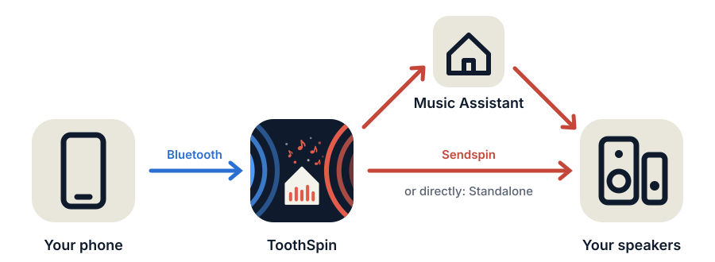
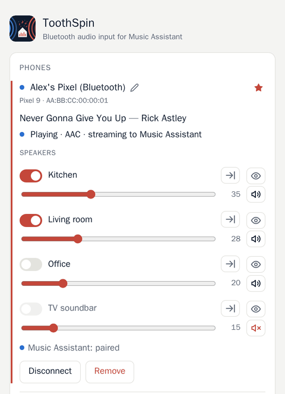

# ToothSpin


**Stream any phone over Bluetooth to your multi-room speakers, with or without Music Assistant.**

[](https://my.home-assistant.io/redirect/supervisor_add_addon_repository/?repository_url=https%3A%2F%2Fgithub.com%2Feknoes%2Ftoothspin)

ToothSpin turns a USB Bluetooth dongle into a Bluetooth speaker for
[Music Assistant](https://music-assistant.io). Your phone pairs with it like
with any other speaker, and whatever it plays shows up in Music Assistant as
a live input. From there it plays on one speaker, a group, or the whole house.
No Music Assistant? ToothSpin Standalone plays straight on Sendspin speakers.

## Why?

I fell for multi-room audio built from open-source [software](https://www.music-assistant.io/)
and [hardware](https://github.com/sonocotta/esparagus-media-center): every
room in sync, nothing in the cloud. My household was less impressed.
Their review: *"Nice. Where's the Bluetooth?"*
Then they paired their phones with whichever speaker was closest, and my
carefully synchronised setup was never used.

ToothSpin is my peace offering. For the phones it's just another Bluetooth
speaker, and the music can still fill one room or all of them.

<p align="center">
  
</p>

## How it works

You pair your phone once with ToothSpin over Bluetooth. After that, connect
the phone like to any Bluetooth speaker (or press **Connect** in ToothSpin),
play something and switch on the speakers you want in ToothSpin's web UI.
The phone's volume buttons then control those speakers.

<p align="center">
  
</p>

It currently supports:
* Several phones on one dongle, each with its own input in Music Assistant
* Picking speakers and groups per phone, with the phone's volume buttons
* Title, artist and cover of what the phone plays, in the web UI
* ToothSpin Standalone: the same without Music Assistant, on Sendspin
  speakers, with title and cover on speakers with a display
* Pairing only while you open the pairing window (or with a PIN)
* Running as a Home Assistant App, in Docker/Podman or on Fedora CoreOS

Not working yet:
* Song title and cover in Music Assistant. Sendspin can't send them for an
  input yet ([Sendspin/backlog#56](https://github.com/Sendspin/backlog/issues/56)),
  ToothSpin's own web UI shows them though (and ToothSpin Standalone sends
  them to the speakers).
* With Music Assistant: after a pause of more than 10 minutes, you have to
  switch the speakers on again.
* Phone calls. ToothSpin only does music.

> [!NOTE]
> ToothSpin is in an early state. I built it over a couple of evenings
> together with [Claude](https://claude.ai). I steered a lot, and reviewed
> the code. By now it runs in a couple of homes. Mine is a demanding test
> lab: several phones, a household that switches
> rooms mid-song, and users who report bugs directly to the maintainer,
> without any technical details and without filing an issue.
> I'd say I tested it a lot, but you still have to expect rough edges.
> Bug reports and feature requests are welcome!

You need a Bluetooth adapter, ideally a USB dongle just for ToothSpin, and
Music Assistant **2.10.7 or newer**, unless you take ToothSpin Standalone (see
below). If you want to know how it's built, see the
[technical overview](https://eknoes.github.io/toothspin/overview.html).

## ToothSpin or ToothSpin Standalone?

ToothSpin comes in two variants:

- **Only the phones over Bluetooth, and only Sendspin speakers?** Take
  **ToothSpin Standalone**. It plays the phones on the speakers itself, no
  Music Assistant needed.
- **Anything else** (other speakers, other music, or Music Assistant runs
  already): take **ToothSpin** and pair it with Music Assistant.

| | **ToothSpin** (with Music Assistant) | **ToothSpin Standalone** |
|---|---|---|
| Speakers | Everything Music Assistant plays on: Sendspin, AirPlay, Chromecast, Squeezebox, Home Assistant media players | Sendspin only, and only those that play for servers they aren't paired with (e.g. ESPHome's) |
| What plays | The phones, plus everything else in Music Assistant (streaming services, radio, your library) | Only the phones |
| Setup | Music Assistant 2.10.7 or newer; each phone pairs with it once (by itself, with an API token) | Nothing to pair besides Bluetooth |
| Title and cover on the speakers | Not yet: Sendspin can't send them for an input. ToothSpin's web UI shows them | Title, artist, album and cover on speakers with a display |

## Install

Pick whatever fits your setup:

- **A Home Assistant App**. It can share Home Assistant's Bluetooth adapter,
  but a second dongle just for ToothSpin is more reliable. (This is how I currently use it)
- **A container on your own Linux machine** (Docker or Podman) also works,
  but you install and configure the host side yourself: BlueZ, and no other
  Bluetooth audio stack.
- **A dedicated Fedora CoreOS machine**. A small VM with its
  own USB Bluetooth dongle passed through. One config file sets up
  everything on first boot. A Raspberry Pi 4 works too, since Fedora
  CoreOS [supports it](https://docs.fedoraproject.org/en-US/fedora-coreos/provisioning-raspberry-pi4/)
  (the Pi 5 isn't supported yet). (This is how I used to run it)

For ToothSpin Standalone, the same three ways work; see
[standalone mode](#standalone-mode).

### As a Home Assistant App

[](https://my.home-assistant.io/redirect/supervisor_add_addon_repository/?repository_url=https%3A%2F%2Fgithub.com%2Feknoes%2Ftoothspin)

Add `https://github.com/eknoes/toothspin` as an app repository (**Settings →
Apps → App store → ⋮ → Repositories**) and install **ToothSpin**. Step by
step: [installation guide](https://eknoes.github.io/toothspin/install.html#home-assistant),
[FAQ](https://eknoes.github.io/toothspin/faq.html).

### With Docker or Podman

The host needs **BlueZ** (`bluetoothd`) with the dongle, ideally with our
[main.conf](deploy/bluetooth/main.conf) so phones see a speaker, and **no
other Bluetooth audio stack** (a desktop PipeWire or PulseAudio would
compete for the phones). The image brings everything else.

```bash
docker build -t toothspin .
docker run -d --name toothspin --restart unless-stopped \
  --network host \
  -v /run/dbus/system_bus_socket:/run/dbus/system_bus_socket \
  -v toothspin-data:/data \
  --user 1000:1000 --cap-drop ALL --security-opt no-new-privileges \
  -e MA_TOKEN=<token> \
  toothspin
```

`--network host` is for finding Music Assistant via mDNS and the web UI on
:8080. `--user 1000:1000` runs ToothSpin as the image's `toothspin` user,
with no capabilities at all. A new volume belongs to that user; for an
existing one or a host folder, hand it over once (`chown -R 1000:1000`).
Without `--user`, ToothSpin starts as root, hands `/data` over itself and
switches; that needs `--cap-add CHOWN --cap-add SETUID --cap-add SETGID`
instead, which it gives up right after. Rootless Podman needs
`--userns keep-id` instead of `--user`, so D-Bus sees your own uid.

On SELinux hosts (Fedora, RHEL, CoreOS), containers may not use the host's
D-Bus. [deploy/selinux/toothspin.cil](deploy/selinux/toothspin.cil) adds a
container type that may, but is otherwise confined like any container. Load
it once and run with `--security-opt label=type:toothspin.process`:

```bash
sudo semodule -i deploy/selinux/toothspin.cil \
  /usr/share/udica/templates/{base_container,net_container}.cil
```

### On a dedicated Fedora CoreOS machine

[deploy/coreos](deploy/coreos/) has a Butane config for a machine (e.g. a
VM with the dongle passed through) that sets everything up on first boot.
Its README walks through adding your SSH key and installing.

The web UI is on `http://<host>:8080/`. It has no login, so keep it on your
home network.

### Configuration

Outside Home Assistant, set these as environment variables (on CoreOS: in
`~/.config/toothspin.env`, then `systemctl --user restart toothspin`). All
are optional:

| Variable | Default | |
|---|---|---|
| `MA_TOKEN` | – | Music Assistant token (your profile → **Tokens**); lets you pick speakers in the web UI and pairs phones automatically |
| `MA_URL` | discovered via mDNS | e.g. `http://192.168.178.91:8095` |
| `SENDSPIN_URL` | discovered via mDNS | e.g. `ws://192.168.178.91:8927/sendspin` |
| `BT_NAME` | `ToothSpin` | Bluetooth name phones see |
| `BT_PIN` | – | 6-16 digits: phones can pair any time with this PIN, not only in the pairing window; needs Secure Simple Pairing off on the host (`deploy/bluetooth/install.sh --pin`) |
| `BT_ADAPTER` | `hci0` | the dongle, e.g. `hci1`; `auto` takes the first one |
| `SENDSPIN_NAME` | `{device} (Bluetooth)` | default name of each phone's input in Music Assistant (rename per phone in the web UI) |
| `SENDSPIN_MANUFACTURER` | host name | manufacturer shown for the inputs in Music Assistant |
| `SENDSPIN_CODEC` | `pcm` | `pcm`, `flac` or `opus` towards Music Assistant |
| `START_VOLUME` | `100` | maximum start volume (0-100): a speaker set louder is turned down to it when a phone starts on it, e.g. `20`; `100` never changes the volume |
| `ALLOW_PHONE_CONNECT` | `true` | `false`: phones only connect via the web UI's **Connect** |
| `OTHER_ADAPTERS_PAIRING` | `accept` | `refuse`: no device can pair with the host's other Bluetooth adapters ([why](https://eknoes.github.io/toothspin/faq.html#other-adapters)) |
| `BT_PAIRING_SECONDS` | `120` | how long **Add phone** keeps pairing open |
| `WEB_PORT` | `8080` | |
| `LOG_LEVEL` | `INFO` | |

## Usage

**Add a phone:** press **Add phone**, then connect to "ToothSpin" in the
phone's Bluetooth settings within two minutes. Outside that window pairing
is refused, unless you set a `BT_PIN`: then phones can pair any time with it.

**Pair it with Music Assistant:** the phone appears there as a new device,
e.g. "Pixel 10 (Bluetooth)". With `MA_TOKEN`, ToothSpin pairs it by itself.
Without, open it in Music Assistant's settings, choose **Pair the device**,
press **Allow pairing** on the phone's card in ToothSpin and enter the code.

**Play:** connect the phone, play something and switch on speakers on its
card. Several speakers form a group (only speakers that can play in sync
are offered together), each with its own volume and mute. The arrow next to
a speaker moves the phone to just that one. A speaker keeps its volume when
a phone starts; then the phone's volume buttons control it. The eye icon
hides speakers on that phone's card.

**Too loud:** cap a speaker where the sound is made (e.g. its amplifier), or
with Music Assistant's per-player **Maximum volume**. `START_VOLUME` turns a
loud speaker down when a phone starts on it.

**Without a token:** play the input from Music Assistant (select a player,
**Browse**, pick the input, **Play**), or set the device's **Automatically
play line-in on**: Music Assistant then starts it when the phone plays.

**Remove** on a phone's card also forgets its Music Assistant pairing, and
with `MA_TOKEN` removes its input there too.

## Design decisions

**Can I stop phones from connecting by themselves?** By default, phones
reconnect to ToothSpin on their own, e.g. when they're switched on or when
you come home. That's what people expect from a Bluetooth speaker. If the
phones always pick up ToothSpin (which can be annoying), set
`ALLOW_PHONE_CONNECT=false`. Then a phone only connects when someone presses
**Connect** in ToothSpin.

**Why do I have to pair every phone, instead of a "free for all"?** Because
you should stay in control of who plays on your speakers. Someone walking
past your home shouldn't be able to connect to your living room. So phones
can only pair while you've opened the pairing window in the web UI, or with
a PIN only you know (`BT_PIN`).

## Standalone mode

ToothSpin Standalone runs its own Sendspin server instead of going through
Music Assistant, with the same web UI, grouping and volume buttons. Which
variant fits: [ToothSpin or ToothSpin Standalone?](#toothspin-or-toothspin-standalone)

To use it, install the Home Assistant App **ToothSpin Standalone** from the
same repository, or use the image `ghcr.io/eknoes/toothspin-standalone`
(about 200 MB larger; it starts in standalone mode).

**Speaker groups:** speakers that always play together, e.g. a left and a
right one, can be one speaker: under **Speaker groups** (top right in the
web UI), group and name them. The phones' cards then show just the group.

**Track info:** speakers with a display show title, artist, album, cover and
position, as far as the phone reports them.

Its extra variables:

| Variable | Default | |
|---|---|---|
| `SERVER_PORT` | `8927` | port of ToothSpin's Sendspin server |
| `SPEAKER_BUFFER_MS` | – | buffer for speakers that don't report their own (older Sendspin versions; otherwise 1000 ms). Less, e.g. `500`, starts playback sooner; too little drops out |

## Tested hardware

What ToothSpin runs on every day at my home:

- **Bluetooth:** a BARROT Bluetooth 6.0 USB dongle (`33fa:0012`), passed
  through to the Home Assistant VM; Android phones.
- **Speakers**, with Music Assistant and in standalone mode:
  - [Louder Esparagus](https://github.com/sonocotta/esparagus-media-center#louder-esparagus)
    and [Louder-ESP32 Mini](https://github.com/sonocotta/esp32-audio-dock#louder-esp32-mini)
    with ESPHome
  - [HiFi-ESP32](https://github.com/sonocotta/esp32-audio-dock#hifi-esp32-and-hifi-esp32-plus)
    with ESPHome, into a stereo amplifier
  - Raspberry Pis with [piCorePlayer](https://www.picoreplayer.org/) and
    `sendspin-cpp-cli`

## More

- [Technical overview](https://eknoes.github.io/toothspin/overview.html):
  how audio gets from the phone to the speakers.
- [DEVELOPMENT.md](DEVELOPMENT.md): running the tests, releasing.
- [SECURITY.md](SECURITY.md): reporting vulnerabilities.

## License

GPL-3.0-or-later, see [LICENSE](LICENSE). Third-party components in the
container image and where to get their source: [LICENSING.md](LICENSING.md).
