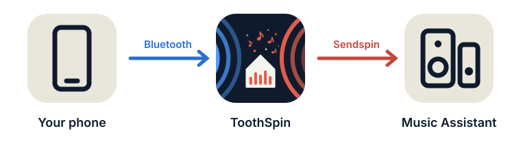

# ToothSpin


**Stream any phone over Bluetooth into Music Assistant.**

I fell for multi-room audio built from open-source [software](https://www.music-assistant.io/) and [hardware](https://github.com/sonocotta/esparagus-media-center):
every room in sync, nothing in the cloud. My household was less impressed.
Their review: *"Nice. Where's the Bluetooth?"* Then they paired their phones
with whichever speaker was closest and left my carefully synchronised setup
to play to an empty house. ToothSpin is my peace offering: to a phone it's
just another Bluetooth speaker, and whatever it plays can fill one room or
all of them.

<p align="center">
  
</p>

## How it works

A USB Bluetooth dongle becomes a speaker your phones can pair with. Each
phone shows up in [Music Assistant](https://music-assistant.io) as its own
live input, and ToothSpin's web UI plays it on any speaker or group.

After pairing your phone with ToothSpin over Bluetooth, it needs one pairing
with Music Assistant to set it up, which ToothSpin does by itself when it has
a token for Music Assistant's API. From then on: connect the phone like to
any Bluetooth speaker (or press **Connect** in ToothSpin), play something
and switch on the speakers you want. The phone's volume buttons control
those speakers.

> [!NOTE]
> ToothSpin is in an early state. It was put together over a couple of
> evenings with [Claude](https://claude.ai), with a human firmly at the
> wheel: the AI got steered a lot, and every line of code was reviewed by
> me. It runs in exactly one home so far, but that home is a demanding test
> lab: several phones, a household that switches rooms mid-song, and
> users who report bugs without any technical details directly at the maintainer, without filing an issue.
> Expect rough edges; bug reports (any volume) are welcome.

**You need:** Music Assistant **2.10.6 or newer** and a USB Bluetooth dongle
just for ToothSpin. How it's built:
[technical overview](https://eknoes.github.io/toothspin/overview.html).

## Install

Pick whatever fits your setup:

- **A dedicated Fedora CoreOS machine** is how I run it: a small VM with its
  own USB Bluetooth dongle passed through. One config file sets up
  everything on first boot. A Raspberry Pi 4 works too, since Fedora
  CoreOS [supports it](https://docs.fedoraproject.org/en-US/fedora-coreos/provisioning-raspberry-pi4/)
  (the Pi 5 isn't supported yet).
- **A Home Assistant App**, if you have a second Bluetooth dongle: Home
  Assistant keeps its own adapter, ToothSpin gets the other one.
- **A container on your own Linux machine** (Docker or Podman) also works,
  but you install and configure the host side yourself: BlueZ, and no other
  Bluetooth audio stack.

### As a Home Assistant App

[](https://my.home-assistant.io/redirect/supervisor_add_addon_repository/?repository_url=https%3A%2F%2Fgithub.com%2Feknoes%2Ftoothspin)

Add `https://github.com/eknoes/toothspin` as an app repository (**Settings →
Apps → App store → ⋮ → Repositories**) and install **ToothSpin**. Setup
details, e.g. keeping Home Assistant's Bluetooth integration off the dongle,
are in the [app's documentation](toothspin/DOCS.md). The web UI opens
through Home Assistant.

### With Docker or Podman

The host needs **BlueZ** (`bluetoothd`) with the dongle, ideally with our
[main.conf](deploy/bluetooth/main.conf) so phones see a speaker, and **no
other Bluetooth audio stack** (a desktop PipeWire or PulseAudio would
compete for the phones). The image brings everything else.

```bash
docker build -t toothspin .
docker run -d --name toothspin --restart unless-stopped \
  --network host \
  -v /run/dbus/system_bus_socket:/run/dbus/system_bus_socket \
  -v toothspin-data:/data \
  --cap-drop ALL --security-opt no-new-privileges \
  -e MA_TOKEN=<token> \
  toothspin
```

`--network host` is for finding Music Assistant via mDNS and the web UI on
:8080. Rootless Podman also needs `--userns keep-id`, so D-Bus sees your own
uid.

On SELinux hosts (Fedora, RHEL, CoreOS), containers may not use the host's
D-Bus. [deploy/selinux/toothspin.cil](deploy/selinux/toothspin.cil) adds a
container type that may, but is otherwise confined like any container. Load
it once and run with `--security-opt label=type:toothspin.process`:

```bash
sudo semodule -i deploy/selinux/toothspin.cil \
  /usr/share/udica/templates/{base_container,net_container}.cil
```

### On a dedicated Fedora CoreOS machine

[deploy/coreos](deploy/coreos/) has a Butane config for a machine (e.g. a
VM with the dongle passed through) that sets everything up on first boot.
Its README walks through adding your SSH key and installing.

The web UI is on `http://<host>:8080/`. It has no login, so keep it on your
home network.

### Configuration

Outside Home Assistant, set these as environment variables (on CoreOS: in
`~/.config/toothspin.env`, then `systemctl --user restart toothspin`). All
are optional:

| Variable | Default | |
|---|---|---|
| `MA_TOKEN` | – | long-lived Music Assistant token (your profile → **Tokens**); enables choosing speakers in the web UI and pairing phones with Music Assistant automatically |
| `MA_URL` | discovered via mDNS | e.g. `http://192.168.178.91:8095` |
| `SENDSPIN_URL` | discovered via mDNS | e.g. `ws://192.168.178.91:8927/sendspin` |
| `BT_NAME` | `Music Assistant` | Bluetooth name phones see |
| `BT_PIN` | – | 6-16 digits: phones can pair any time with this PIN instead of only during the pairing window; needs Secure Simple Pairing off on the host (`deploy/bluetooth/install.sh --pin`) |
| `BT_ADAPTER` | `hci0` | the dongle |
| `SENDSPIN_NAME` | `{device} (Bluetooth)` | default name of each phone's input in Music Assistant (rename per phone in the web UI) |
| `SENDSPIN_MANUFACTURER` | host name | manufacturer shown for the inputs in Music Assistant |
| `SENDSPIN_CODEC` | `pcm` | `pcm`, `flac` or `opus` towards Music Assistant |
| `START_VOLUME` | `100` | the loudest a speaker starts at (0-100) when a phone starts playing on it, e.g. `20` so a speaker someone left loud doesn't blast; quieter speakers keep their volume, `100` always keeps it |
| `ALLOW_PHONE_CONNECT` | `true` | `false` only accepts connections started from the web UI's **Connect**, never from the phone |
| `BT_PAIRING_SECONDS` | `120` | how long **Add phone** keeps pairing open |
| `WEB_PORT` | `8080` | |
| `LOG_LEVEL` | `INFO` | |

## Usage

**Add a phone:** press **Add phone** in the web UI; the dongle is visible
for two minutes. On the phone, connect to the Bluetooth name (default
"Music Assistant"). Outside that window, pairing is refused, unless you set
a `BT_PIN`: then phones can pair any time by entering it.

**Pair it with Music Assistant:** the phone now appears in Music Assistant
as a new device, e.g. "Pixel 10 (Bluetooth)". With `MA_TOKEN` set, ToothSpin
pairs it by itself within a few seconds. Without, open it in Music
Assistant's settings and choose **Pair the device**; then press **Allow** on
the phone's card in ToothSpin and type the code it shows into Music
Assistant.

**Play:** press **Connect** on the phone's card, play something on the
phone, then switch on speakers on its card. Several speakers form a group
on the fly (only speakers that can play in sync are offered together), each
with its own volume and mute. To switch rooms, the arrow next to a speaker
moves the phone there in one go, off all the others. On connecting, the
phone takes over the speaker's volume instead of imposing its own, so
nothing suddenly gets loud; after that, its volume buttons control the
speaker or group. The eye icon hides speakers you don't need on that phone's
card.

**Speakers that get too loud:** cap them where the sound is made, e.g. the
amplifier's hardware volume on the speaker, or Music Assistant's per-player
**Maximum volume** (which rescales 0-100% to that maximum). Or have speakers
start no louder than `START_VOLUME` when a phone starts on them.

Without a Music Assistant token, start the input from Music Assistant
instead: select a player, open **Browse**, pick the phone's input and press
**Play**. Or set the device's **Automatically play line-in on** setting:
Music Assistant then starts it when the phone plays and stops a minute after
it goes quiet.

**Remove** on a phone's card also forgets its Music Assistant pairing. With
`MA_TOKEN` set, ToothSpin removes the phone's input from Music Assistant too;
otherwise remove the matching device there yourself.

## Design decisions

**Can connections be limited to ToothSpin?** Phones reconnect to known
Bluetooth devices on their own, e.g. right after being switched on or when
you come home, which is what people expect from a Bluetooth speaker. If you
worry that this could start whatever a phone plays on every speaker in the
house by accident, set `ALLOW_PHONE_CONNECT=false`: then a phone only
connects when someone presses **Connect** in ToothSpin. Either way, a phone
only plays on speakers switched on for it, unless Music Assistant is set to
start its input automatically.

**Why pair manually, instead of a "free for all"?** To stay in control of
who plays on your speakers. Someone walking past your home shouldn't be able
to connect to your living room speaker. Phones can only pair while you've
opened the pairing window in the web UI, or with a PIN only you know
(`BT_PIN`), and each one needs a one-time pairing with Music Assistant
before it can play anywhere.

## More

- [Technical overview](https://eknoes.github.io/toothspin/overview.html):
  how audio gets from the phone into Music Assistant.
- [DEVELOPMENT.md](DEVELOPMENT.md): running the tests, releasing.
- [SECURITY.md](SECURITY.md): reporting vulnerabilities.

## License

GPL-3.0-or-later, see [LICENSE](LICENSE). Third-party components in the
container image and where to get their source: [LICENSING.md](LICENSING.md).
